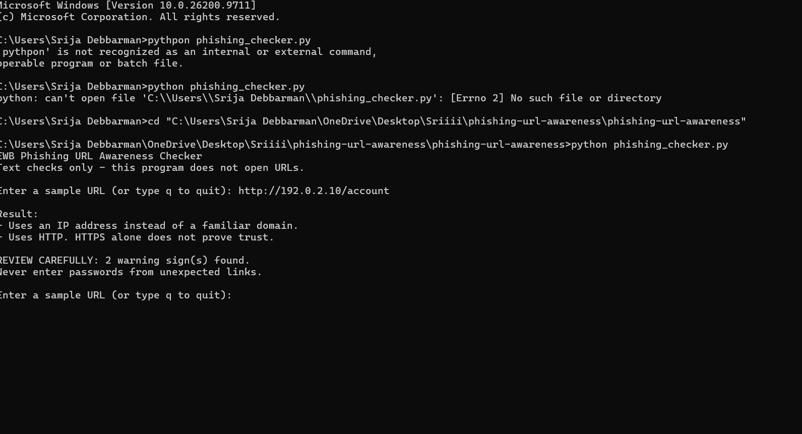
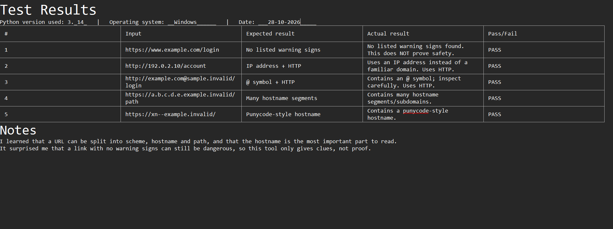

# EWB Phishing URL Awareness Checker

## Overview
Phishing is a trick where criminals send fake links or messages to make people share passwords or payment details. This small Python tool reads the text of a URL and points out a few visible warning signs. It never opens the link.

## Features
- Detects an @ symbol in the URL
- Flags unusually long URLs (over 100 characters)
- Flags IP-address hostnames
- Flags many hostname segments (5 or more)
- Flags punycode-style hostnames (xn--)
- Flags the HTTP scheme

## Requirements
Python 3.10 or later. No extra packages.

## How to Run
Windows:   python phishing_checker.py
Mac/Linux: python3 phishing_checker.py

## Example Output
```
EWB Phishing URL Awareness Checker
Text checks only - this program does not open URLs.

Enter a sample URL (or type q to quit): http://192.0.2.10/account

Result:
- Uses an IP address instead of a familiar domain.
- Uses HTTP. HTTPS alone does not prove trust.

REVIEW CAREFULLY: 2 warning sign(s) found.
Never enter passwords from unexpected links.
```

## Testing
| # | Input | Expected | Actual | Result |
|---|-------|----------|--------|--------|
| 1 | https://www.example.com/login | No warning signs | No listed warning signs found | PASS |
| 2 | http://192.0.2.10/account | IP address + HTTP | IP address and HTTP flagged | PASS |
| 3 | http://example.com@sample.invalid/login | @ symbol + HTTP | @ symbol and HTTP flagged | PASS |
| 4 | https://a.b.c.d.e.example.invalid/path | Many segments | Many hostname segments flagged | PASS |
| 5 | https://xn--example.invalid/ | Punycode hostname | Punycode flagged | PASS |

Full table is in tests/test_samples.md

## Screenshots



## Improvements
1. Loop with quit - the program now keeps asking for URLs until I type q, so I can test many links in one run. I tested it by entering several URLs and then q.
2. Crash fix for bad input - invalid text such as `http://[bad` used to crash with a ValueError. Now a try/except returns a friendly message. I tested it by typing `http://[bad` and re-running all five tests.

## Limitations
This is an educational tool. It only reads URL text. It does not visit URLs, scan for malware or prove that a URL is safe. No warning signs found does NOT mean a URL is safe.

## Ethical Use
Use sample strings only. Do not collect credentials. Do not use this project to deceive anyone or to test websites without permission.

## Author
Srija Debbarma, [AI Powered Cybersecurity], EWB Courses
